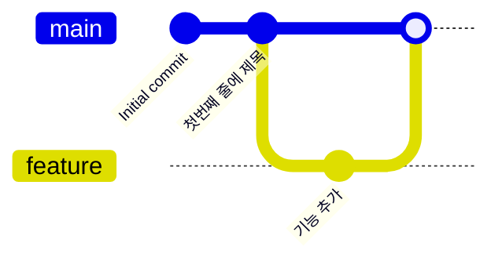
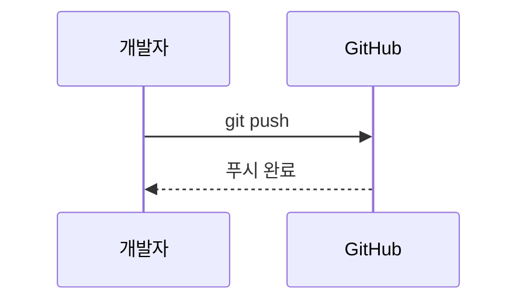

# GitPractice
Git Practice sample

---

# 📘 마크다운(Markdown) 문법 완벽 가이드

> 이 문서는 마크다운 문법을 **예시 코드**와 **실제 렌더링 결과**를 함께 보여주며 정리한 가이드입니다.
> GitHub Flavored Markdown(GFM) 기준으로 작성되었습니다.

## 📑 목차

1. [제목 (Headers)](#1-제목-headers)
2. [문단과 줄바꿈](#2-문단과-줄바꿈)
3. [텍스트 강조](#3-텍스트-강조)
4. [인용문 (Blockquote)](#4-인용문-blockquote)
5. [목록 (List)](#5-목록-list)
6. [체크박스 (Task List)](#6-체크박스-task-list)
7. [코드 (Code)](#7-코드-code)
8. [링크 (Link)](#8-링크-link)
9. [이미지 (Image)](#9-이미지-image)
10. [표 (Table)](#10-표-table)
11. [수평선 (Horizontal Rule)](#11-수평선-horizontal-rule)
12. [이스케이프 문자](#12-이스케이프-문자-escape)
13. [각주 (Footnote)](#13-각주-footnote)
14. [HTML 태그 사용](#14-html-태그-사용)
15. [접기/펼치기 (Details)](#15-접기펼치기-details)
16. [이모지 (Emoji)](#16-이모지-emoji)
17. [수식 (Math)](#17-수식-math)
18. [다이어그램 (Mermaid)](#18-다이어그램-mermaid)
19. [알림 블록 (Alerts)](#19-알림-블록-alerts)
20. [GitHub 전용 기능](#20-github-전용-기능)

---

## 1. 제목 (Headers)

`#`의 개수로 제목의 레벨(1~6)을 지정합니다. `#` 뒤에는 **반드시 공백**을 넣어야 합니다.

```markdown
# 제목 1 (H1)
## 제목 2 (H2)
### 제목 3 (H3)
#### 제목 4 (H4)
##### 제목 5 (H5)
###### 제목 6 (H6)
```

**결과:**

# 제목 1 (H1)
## 제목 2 (H2)
### 제목 3 (H3)
#### 제목 4 (H4)
##### 제목 5 (H5)
###### 제목 6 (H6)

### 대체 문법 (Setext 스타일)

H1과 H2는 아래처럼 `=`, `-` 밑줄로도 표현할 수 있습니다.

```markdown
제목 1
======

제목 2
------
```

> 💡 **팁:** 문서에서 H1은 보통 한 번만(문서 제목) 사용하고, 그 아래로 H2, H3를 계층적으로 사용하는 것이 좋습니다.

---

## 2. 문단과 줄바꿈

### 문단 (Paragraph)

빈 줄 하나로 문단을 구분합니다.

```markdown
첫 번째 문단입니다.

두 번째 문단입니다.
```

### 줄바꿈 (Line Break)

그냥 엔터만 치면 줄바꿈이 **되지 않습니다.** 다음 방법 중 하나를 사용하세요.

| 방법 | 작성법 |
|------|--------|
| 줄 끝에 공백 2칸 | `첫 줄␣␣` (␣ = 공백) |
| 줄 끝에 백슬래시 | `첫 줄\` |
| HTML 태그 | `첫 줄<br>` |

```markdown
첫 번째 줄<br>
두 번째 줄
```

**결과:**

첫 번째 줄<br>
두 번째 줄

---

## 3. 텍스트 강조

| 스타일 | 문법 | 결과 |
|--------|------|------|
| 굵게 | `**텍스트**` 또는 `__텍스트__` | **텍스트** |
| 기울임 | `*텍스트*` 또는 `_텍스트_` | *텍스트* |
| 굵게 + 기울임 | `***텍스트***` | ***텍스트*** |
| 취소선 | `~~텍스트~~` | ~~텍스트~~ |
| 인라인 코드 | `` `텍스트` `` | `텍스트` |
| 밑줄 (HTML) | `<ins>텍스트</ins>` | <ins>텍스트</ins> |
| 위 첨자 (HTML) | `x<sup>2</sup>` | x<sup>2</sup> |
| 아래 첨자 (HTML) | `H<sub>2</sub>O` | H<sub>2</sub>O |
| 키보드 키 (HTML) | `<kbd>Ctrl</kbd> + <kbd>C</kbd>` | <kbd>Ctrl</kbd> + <kbd>C</kbd> |
| 형광펜 (HTML) | `<mark>텍스트</mark>` | <mark>텍스트</mark> |

### 중첩 사용

```markdown
**굵은 글씨 안에 _기울임_ 을 넣을 수 있어요**
```

**결과:** **굵은 글씨 안에 _기울임_ 을 넣을 수 있어요**

> ⚠️ **주의:** 한글 단어 중간에서 `**`를 쓰면 렌더링이 안 되는 경우가 있습니다.
> 예: `이것은**굵게**입니다` → 앞뒤에 공백을 두거나 `<b>` 태그를 사용하세요.

---

## 4. 인용문 (Blockquote)

`>` 기호를 사용합니다.

```markdown
> 이것은 인용문입니다.
> 여러 줄로 작성할 수 있습니다.
```

**결과:**

> 이것은 인용문입니다.
> 여러 줄로 작성할 수 있습니다.

### 중첩 인용문

```markdown
> 1단계 인용
>> 2단계 인용
>>> 3단계 인용
```

**결과:**

> 1단계 인용
>> 2단계 인용
>>> 3단계 인용

### 인용문 안에 다른 문법 사용

```markdown
> ### 인용문 속 제목
> - 목록 1
> - 목록 2
>
> **굵은 글씨**와 `코드`도 가능합니다.
```

**결과:**

> ### 인용문 속 제목
> - 목록 1
> - 목록 2
>
> **굵은 글씨**와 `코드`도 가능합니다.

---

## 5. 목록 (List)

### 순서 없는 목록 (Unordered List)

`-`, `*`, `+` 중 아무거나 사용할 수 있습니다. 들여쓰기(공백 2~4칸)로 중첩합니다.

```markdown
- 과일
  - 사과
  - 바나나
    - 노란 바나나
    - 초록 바나나
- 채소
  * 당근
  + 양파
```

**결과:**

- 과일
  - 사과
  - 바나나
    - 노란 바나나
    - 초록 바나나
- 채소
  * 당근
  + 양파

### 순서 있는 목록 (Ordered List)

숫자와 점(`.`)을 사용합니다. **실제 숫자는 상관없이** 첫 번째 숫자부터 자동으로 매겨집니다.

```markdown
1. 첫 번째
2. 두 번째
   1. 하위 항목 A
   2. 하위 항목 B
3. 세 번째

1. 숫자를 모두 1로 써도
1. 자동으로
1. 순서가 매겨집니다
```

**결과:**

1. 첫 번째
2. 두 번째
   1. 하위 항목 A
   2. 하위 항목 B
3. 세 번째

1. 숫자를 모두 1로 써도
1. 자동으로
1. 순서가 매겨집니다

### 혼합 목록

````markdown
1. Git 설치
   - Windows: 공식 사이트에서 다운로드
   - Mac: `brew install git`
2. 사용자 설정
   ```bash
   git config --global user.name "이름"
   ```
````

### 목록 안에 문단 넣기

목록 항목 아래에 들여쓰기를 맞추면 같은 항목에 속한 문단이 됩니다.

```markdown
1. 첫 번째 항목

   이 문단은 첫 번째 항목에 속합니다.

2. 두 번째 항목
```

---

## 6. 체크박스 (Task List)

GitHub에서 지원하는 할 일 목록입니다.

```markdown
- [x] Git 설치하기
- [x] 저장소 만들기
- [ ] 첫 커밋 하기
- [ ] 브랜치 만들기
  - [x] 하위 작업 완료
  - [ ] 하위 작업 미완료
```

**결과:**

- [x] Git 설치하기
- [x] 저장소 만들기
- [ ] 첫 커밋 하기
- [ ] 브랜치 만들기
  - [x] 하위 작업 완료
  - [ ] 하위 작업 미완료

---

## 7. 코드 (Code)

### 인라인 코드

백틱(`` ` ``) 한 개로 감쌉니다.

```markdown
`git status` 명령어로 상태를 확인합니다.
```

**결과:** `git status` 명령어로 상태를 확인합니다.

코드 안에 백틱이 포함되어 있다면 백틱 **두 개**로 감쌉니다: ``` `` `백틱` `` ```

### 코드 블록

백틱 세 개(` ``` `) 또는 물결표 세 개(`~~~`)로 감쌉니다. 뒤에 **언어 이름**을 쓰면 문법 강조(Syntax Highlighting)가 적용됩니다.

````markdown
```python
def hello(name):
    print(f"Hello, {name}!")

hello("World")
```
````

**결과:**

```python
def hello(name):
    print(f"Hello, {name}!")

hello("World")
```

### 자주 쓰는 언어 식별자

| 언어 | 식별자 | 언어 | 식별자 |
|------|--------|------|--------|
| Python | `python`, `py` | JavaScript | `javascript`, `js` |
| TypeScript | `typescript`, `ts` | Java | `java` |
| C / C++ | `c`, `cpp` | C# | `csharp`, `cs` |
| HTML | `html` | CSS | `css` |
| JSON | `json` | YAML | `yaml`, `yml` |
| Bash / Shell | `bash`, `sh` | PowerShell | `powershell`, `ps1` |
| SQL | `sql` | Markdown | `markdown`, `md` |
| Diff | `diff` | 일반 텍스트 | `text`, `plaintext` |

### 여러 언어 예시

```javascript
const greet = (name) => {
  console.log(`Hello, ${name}!`);
};
```

```bash
git add .
git commit -m "첫 커밋"
git push origin main
```

```json
{
  "name": "GitPractice",
  "version": "1.0.0"
}
```

### Diff (변경 사항 표시)

```diff
- 삭제된 줄입니다
+ 추가된 줄입니다
  변경 없는 줄입니다
```

### 들여쓰기 코드 블록

공백 4칸(또는 탭 1개)으로 들여쓰면 코드 블록이 됩니다. (문법 강조는 불가)

    이것도 코드 블록입니다.
    print("hello")

---

## 8. 링크 (Link)

### 인라인 링크

```markdown
[GitHub](https://github.com)
[GitHub 툴팁 포함](https://github.com "마우스를 올려보세요")
```

**결과:** [GitHub](https://github.com) / [GitHub 툴팁 포함](https://github.com "마우스를 올려보세요")

### 자동 링크

```markdown
<https://www.google.com>
<example@email.com>
https://github.com  ← GitHub에서는 URL만 써도 자동 링크
```

**결과:** <https://www.google.com>

### 참조 링크 (Reference Link)

링크가 많을 때 본문을 깔끔하게 유지할 수 있습니다.

```markdown
[구글][1]과 [네이버][naver]를 방문하세요.

[1]: https://www.google.com
[naver]: https://www.naver.com "네이버"
```

**결과:** [구글][1]과 [네이버][naver]를 방문하세요.

[1]: https://www.google.com
[naver]: https://www.naver.com "네이버"

### 문서 내부 링크 (앵커)

제목은 자동으로 앵커가 생성됩니다. 규칙: 소문자로 변환, 공백은 `-`로, 특수문자는 제거.

```markdown
[목차로 이동](#-목차)
[코드 섹션으로 이동](#7-코드-code)
```

**결과:** [코드 섹션으로 이동](#7-코드-code)

### 저장소 내 파일 링크 (상대 경로)

```markdown
[test.py 파일 보기](./test.py)
```

**결과:** [test.py 파일 보기](./test.py)

---

## 9. 이미지 (Image)

링크 문법 앞에 `!`를 붙입니다.

```markdown


```

**결과:**


### 이미지 크기 조절 (HTML 사용)

마크다운 자체로는 크기 조절이 안 되므로 HTML 태그를 사용합니다.

```html

```

**결과:**


### 이미지에 링크 걸기

```markdown
[](링크_URL)
```

### 이미지 가운데 정렬

```html
<p align="center">
  
</p>
```

### 배지 (Badge)

README에서 자주 쓰는 배지는 [shields.io](https://shields.io)에서 만들 수 있습니다.

```markdown


```

**결과:**


---

## 10. 표 (Table)

`|`로 열을 나누고, 두 번째 줄에 `---`로 헤더를 구분합니다.

```markdown
| 이름 | 나이 | 직업 |
|------|------|------|
| 철수 | 25 | 개발자 |
| 영희 | 28 | 디자이너 |
```

**결과:**

| 이름 | 나이 | 직업 |
|------|------|------|
| 철수 | 25 | 개발자 |
| 영희 | 28 | 디자이너 |

### 정렬

`:`의 위치로 정렬을 지정합니다.

```markdown
| 왼쪽 정렬 | 가운데 정렬 | 오른쪽 정렬 |
|:----------|:-----------:|------------:|
| 왼쪽 | 가운데 | 오른쪽 |
| 1 | 2 | 3 |
```

**결과:**

| 왼쪽 정렬 | 가운데 정렬 | 오른쪽 정렬 |
|:----------|:-----------:|------------:|
| 왼쪽 | 가운데 | 오른쪽 |
| 1 | 2 | 3 |

### 표 안에서 다른 문법 사용

```markdown
| 명령어 | 설명 | 중요도 |
|--------|------|:------:|
| `git init` | 저장소 **초기화** | ⭐⭐⭐ |
| `git add` | 스테이징 영역에 *추가* | ⭐⭐⭐ |
| `git commit` | 변경사항 저장<br>(줄바꿈은 `<br>`) | ⭐⭐⭐ |
| `git log` | [기록 보기](https://git-scm.com/docs/git-log) | ⭐⭐ |
| 파이프 문자 | `\|` 로 이스케이프 | ⭐ |
```

**결과:**

| 명령어 | 설명 | 중요도 |
|--------|------|:------:|
| `git init` | 저장소 **초기화** | ⭐⭐⭐ |
| `git add` | 스테이징 영역에 *추가* | ⭐⭐⭐ |
| `git commit` | 변경사항 저장<br>(줄바꿈은 `<br>`) | ⭐⭐⭐ |
| `git log` | [기록 보기](https://git-scm.com/docs/git-log) | ⭐⭐ |
| 파이프 문자 | `\|` 로 이스케이프 | ⭐ |

> 💡 **팁:** 셀 병합은 마크다운 표에서 지원되지 않습니다. 필요하면 HTML `<table>`의 `colspan`, `rowspan`을 사용하세요.

---

## 11. 수평선 (Horizontal Rule)

아래 세 가지 모두 같은 수평선을 만듭니다. (3개 이상)

```markdown
---
***
___
```

**결과:**

---

> ⚠️ **주의:** 텍스트 바로 아래 줄에 `---`를 쓰면 H2 제목으로 인식됩니다. 수평선 위에는 빈 줄을 두세요.

---

## 12. 이스케이프 문자 (Escape)

마크다운 기호를 문자 그대로 표시하려면 앞에 `\`를 붙입니다.

```markdown
\*별표가 그대로 보입니다\*
\# 제목이 아닙니다
\[링크가 아닙니다\](주소)
```

**결과:**

\*별표가 그대로 보입니다\*<br>
\# 제목이 아닙니다<br>
\[링크가 아닙니다\](주소)

### 이스케이프 가능한 문자

```
\   백슬래시        `   백틱           *   별표
_   언더스코어      {}  중괄호         []  대괄호
()  소괄호          #   샵             +   더하기
-   빼기            .   마침표         !   느낌표
|   파이프          <>  꺾쇠괄호
```

---

## 13. 각주 (Footnote)

```markdown
Git은 리누스 토르발스가 만들었습니다.[^1]
마크다운은 존 그루버가 만들었습니다.[^gruber]

[^1]: 2005년, 리눅스 커널 개발을 위해 만들어졌습니다.
[^gruber]: 2004년에 발표되었습니다.
```

**결과:**

Git은 리누스 토르발스가 만들었습니다.[^1]
마크다운은 존 그루버가 만들었습니다.[^gruber]

[^1]: 2005년, 리눅스 커널 개발을 위해 만들어졌습니다.
[^gruber]: 2004년에 발표되었습니다.

> 각주 내용은 문서 맨 아래에 자동으로 모입니다.

---

## 14. HTML 태그 사용

마크다운 안에서 대부분의 HTML 태그를 사용할 수 있습니다. (단, GitHub에서는 `<script>`, `<style>`, `style` 속성 등 보안상 일부가 제거됩니다.)

```html
<p align="center">
  <b>가운데 정렬된 굵은 글씨</b>
</p>

<div align="right">오른쪽 정렬</div>

<table>
  <tr>
    <th colspan="2">병합된 헤더</th>
  </tr>
  <tr>
    <td>셀 1</td>
    <td>셀 2</td>
  </tr>
</table>
```

**결과:**

<p align="center">
  <b>가운데 정렬된 굵은 글씨</b>
</p>

<div align="right">오른쪽 정렬</div>

<table>
  <tr>
    <th colspan="2">병합된 헤더</th>
  </tr>
  <tr>
    <td>셀 1</td>
    <td>셀 2</td>
  </tr>
</table>

### 주석 (화면에 보이지 않음)

```markdown
<!-- 이 내용은 렌더링되지 않습니다 -->
```

<!-- 이 내용은 렌더링되지 않습니다 -->

---

## 15. 접기/펼치기 (Details)

긴 내용을 숨길 때 유용합니다.

````html
<details>
<summary>👉 클릭해서 펼치기</summary>

숨겨진 내용입니다. **마크다운 문법**도 쓸 수 있어요.

- 항목 1
- 항목 2

```python
print("숨겨진 코드")
```

</details>
````

**결과:**

<details>
<summary>👉 클릭해서 펼치기</summary>

숨겨진 내용입니다. **마크다운 문법**도 쓸 수 있어요.

- 항목 1
- 항목 2

```python
print("숨겨진 코드")
```

</details>

> 💡 `<summary>` 다음과 `</details>` 앞에 **빈 줄**을 넣어야 내부 마크다운이 정상적으로 렌더링됩니다.
> 기본으로 펼쳐두려면 `<details open>`을 사용하세요.

---

## 16. 이모지 (Emoji)

GitHub에서는 `:이름:` 형식의 단축코드를 지원합니다. 이모지를 직접 붙여넣어도 됩니다.

| 단축코드 | 결과 | 단축코드 | 결과 |
|----------|:----:|----------|:----:|
| `:smile:` | :smile: | `:rocket:` | :rocket: |
| `:+1:` | :+1: | `:fire:` | :fire: |
| `:heart:` | :heart: | `:star:` | :star: |
| `:warning:` | :warning: | `:bug:` | :bug: |
| `:white_check_mark:` | :white_check_mark: | `:x:` | :x: |
| `:memo:` | :memo: | `:tada:` | :tada: |

전체 목록: [Emoji Cheat Sheet](https://github.com/ikatyang/emoji-cheat-sheet)

---

## 17. 수식 (Math)

GitHub는 LaTeX 문법의 수식을 지원합니다.

### 인라인 수식

```markdown
아인슈타인의 공식은 $E = mc^2$ 입니다.
```

**결과:** 아인슈타인의 공식은 $E = mc^2$ 입니다.

### 블록 수식

```markdown
$$
\sum_{i=1}^{n} i = \frac{n(n+1)}{2}
$$
```

**결과:**

$$
\sum_{i=1}^{n} i = \frac{n(n+1)}{2}
$$

---

## 18. 다이어그램 (Mermaid)

GitHub는 ` ```mermaid ` 코드 블록을 다이어그램으로 렌더링합니다.

### 플로우차트

````markdown

````

**결과:**


### Git 그래프



### 시퀀스 다이어그램



---

## 19. 알림 블록 (Alerts)

GitHub에서 지원하는 강조 박스입니다.

```markdown
> [!NOTE]
> 참고할 만한 정보입니다.

> [!TIP]
> 더 잘 사용하기 위한 팁입니다.

> [!IMPORTANT]
> 꼭 알아야 하는 중요한 정보입니다.

> [!WARNING]
> 주의가 필요한 내용입니다.

> [!CAUTION]
> 위험하거나 부정적인 결과를 초래할 수 있는 내용입니다.
```

**결과:**

> [!NOTE]
> 참고할 만한 정보입니다.

> [!TIP]
> 더 잘 사용하기 위한 팁입니다.

> [!IMPORTANT]
> 꼭 알아야 하는 중요한 정보입니다.

> [!WARNING]
> 주의가 필요한 내용입니다.

> [!CAUTION]
> 위험하거나 부정적인 결과를 초래할 수 있는 내용입니다.

---

## 20. GitHub 전용 기능

GitHub의 이슈, PR, 커밋 메시지, 댓글 등에서 사용할 수 있는 기능입니다.

| 기능 | 문법 | 설명 |
|------|------|------|
| 사용자 멘션 | `@사용자명` | 해당 사용자에게 알림 |
| 이슈/PR 참조 | `#123` | 123번 이슈/PR로 링크 |
| 다른 저장소 이슈 | `사용자/저장소#123` | 다른 저장소의 이슈 링크 |
| 커밋 참조 | `fc3253a` | 커밋 SHA로 자동 링크 |
| 이슈 자동 닫기 | `Closes #123`, `Fixes #123` | PR 머지 시 이슈 자동 종료 |
| 색상 미리보기 | `` `#0969DA` `` | 색상 칩 표시 (이슈/PR/댓글) |

---

## 📝 빠른 참조표 (Cheat Sheet)

| 요소 | 문법 |
|------|------|
| 제목 | `# H1` ~ `###### H6` |
| 굵게 | `**굵게**` |
| 기울임 | `*기울임*` |
| 취소선 | `~~취소선~~` |
| 인용 | `> 인용문` |
| 순서 없는 목록 | `- 항목` |
| 순서 있는 목록 | `1. 항목` |
| 체크박스 | `- [ ]` / `- [x]` |
| 인라인 코드 | `` `코드` `` |
| 코드 블록 | ` ```언어 ... ``` ` |
| 링크 | `[텍스트](URL)` |
| 이미지 | `` |
| 표 | `\| 헤더 \|` + `\|---\|` |
| 수평선 | `---` |
| 각주 | `[^1]` + `[^1]: 내용` |
| 줄바꿈 | 줄 끝 공백 2칸 또는 `<br>` |
| 이스케이프 | `\*` |
| 접기 | `<details><summary>제목</summary>내용</details>` |
| 수식 | `$인라인$`, `$$블록$$` |
| 알림 | `> [!NOTE]` |

---

## 📚 참고 자료

- [GitHub 공식 문서 - 기본 서식 구문](https://docs.github.com/ko/get-started/writing-on-github/getting-started-with-writing-and-formatting-on-github/basic-writing-and-formatting-syntax)
- [GitHub Flavored Markdown 명세](https://github.github.com/gfm/)
- [Markdown Guide](https://www.markdownguide.org/)
- [Mermaid 공식 문서](https://mermaid.js.org/)

<p align="center">
  <sub>Made with ❤️ for Git Practice</sub>
</p>

[⬆ 맨 위로](#gitpractice)
